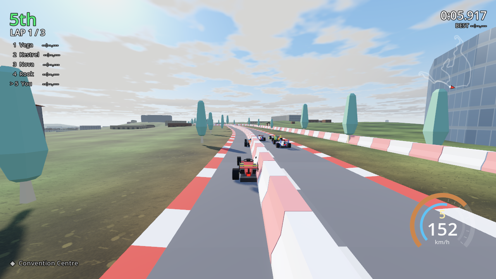

# Astra Racer



A 3D arcade racing game for Godot 4.7: point-to-point car physics with real
slip, four AI opponents that brake for corners they have not reached yet, three
circuits, lap timing and a finished race you can be beaten in.

Built for a steering wheel: the whole input layer is designed around analogue
steering and pedals, and it ships with an Arduino sketch that turns a Pro Micro
and three pots into a wheel the game already understands.

## What you need

- **Godot 4.7** or newer, the standard build — not the .NET one. Get it from
  [godotengine.org/download](https://godotengine.org/download) and put
  `godot` on your `PATH` so the commands below work.
- A 3D-capable graphics card. The project uses the Forward+ renderer.
- **Python 3.10+** with `pip install -r requirements.txt` only if you want to
  run the asset pipeline in `tools/` or the pixel checks in `tests/`. Playing
  and changing the game needs none of it.
- About 180 MB of disk for a clean clone. The terrain and city meshes are
  large, so the first clone takes a moment; Git LFS is not required.

## Quick start

```bash
git clone https://github.com/ntirushwajeanmarc/astra-racer.git
cd astra-racer
godot --path .        # or: open this folder in the Godot editor and press F5
```

You do not need an account, a fork or anyone's permission to download and run
this — the repository is public. The clone above is read-only for everyone; to
change the game and send the change back, fork it first, which is one button on
the project page and needs nothing from us.

The entry point is the menu: pick a circuit, rivals, laps and difficulty, then
**RACE**. You start at the back of the grid, which is the arcade convention and
the only reason the AI is worth chasing.

The first launch imports the assets and builds the `.godot/` folder; that is
normal, it is ignored by git, and it takes a few seconds. If the game reports a
missing resource, let the editor finish importing and run it again. Running the
checks on a fresh clone before the editor has ever opened the project? Import
first, once:

```bash
godot --headless --path . --import
```

## Repository layout

| path | what lives there |
|---|---|
| `project.godot` | the Godot project — open this folder, not a subfolder |
| `scenes/` | the menu, the race, and the benchmark, physics and capture scenes the checks drive |
| `scripts/` | all game code: `car/`, `track/`, `race/`, `ui/`, `core/`, `tools/` |
| `assets/` | Kenney model kit, generated sky, terrain and city, with their licences |
| `audio/` | synthesised sound effects (`.wav` plus Godot's `.import` files) |
| `addons/godot_mcp/` | editor add-on that lets an AI assistant drive the editor |
| `arduino/wheel_hid/` | the steering-wheel firmware |
| `tools/` | the offline asset pipeline — GPX to track, DEM to terrain, OSM to city, sky and audio |
| `tests/` | Python checks that hold the engine to the assets and the assets to the engine |
| `docs/` | the Arduino wheel wiring guide and the screenshots used above |

If you want to help, read [CONTRIBUTING.md](CONTRIBUTING.md) — it covers the
git workflow, the house style the code is written in, and how to run the checks
before you open a pull request.

## Controls

| | keyboard | wheel / gamepad |
|---|---|---|
| steer | A / D or ← / → | wheel, or axis 0 |
| throttle | W or ↑ | pedal, or axis 2 / 5 / 1 |
| brake / reverse | S or ↓ | pedal, or axis 3 / 4 / 1 |
| handbrake | Space | B or LB |
| boost | Shift | X |
| reset car | R | Y |
| camera | C | D-pad up |
| look back | Tab | — |
| pause | Esc | Start |

**CONTROLS & WHEEL** on the menu shows every axis of any attached device live,
and the *learn* buttons bind steering, throttle and brake by simply moving them.
See `docs/ARDUINO_WHEEL.md` for the wiring and the sketch.

## The circuits

Both are generated from a handful of control points, smoothed with Catmull-Rom
and resampled at exactly two-metre spacing, so "distance along the lap" is
linear and the AI's look-ahead is arithmetic rather than guesswork.

| | Sunset Speedway | Alpine Loop | Kigali |
|---|---|---|---|
| length | 1522 m | 1250 m | 14 362 m |
| character | long straight, one huge sweeper, a chicane | the mirror image, tighter and hilly | the 2025 World Championships local circuit, on the city's own streets |
| road width | 12 m | 10.4 m | 10 m |
| tightest corner | 37 m radius | 31 m radius | 15.9 m radius |

### Kigali

Kigali is imported, not designed. `tools/gpx_to_track.py` turns the official
course into track data and `tools/fetch_dem.py` and `tools/fetch_buildings.py`
bring its ground and its city.

A race route is not a racing line, and this one is a **bike** route drawn by hand
over 15 km of streets: vertex spacing from 1.1 m to 220 m, corners of about 6 m,
and places where the line passes within 6 m of itself four kilometres further
round. None of that can be occupied by a road with barriers down both sides, so
the converter relaxes the driven line until it passes the same geometry rules the
game enforces on its own circuits - which is why the lap is 14.4 km rather than
15.1, and why the line departs from the drawn route by up to 127 m at the worst
of the two doubled-back stretches. Everywhere else it is on the real road.

### The ground under it

The terrain starts as a 30 m elevation model (SRTM-derived) placed in the
circuit's own frame, and `tools/build_terrain.py` turns it into ground:

- **It is resampled finer than the data.** The model's own 25 m step is about
  the size of a house, so the ground beside the road was one flat facet per
  four car-lengths. It is resampled to 12.5 m through a Catmull-Rom fit — the
  same hill, read at a finer step — and then given a metre or so of fractal
  relief, leaning on slope, because the real ground between two SRTM samples is
  not the straight line between them and a few octaves is a better guess at it
  than flat.
- **The road is cut into it.** Every pixel within 16 m of the centreline is
  pulled to the road's height and tapers back to the real ground over 110 m,
  which is what a road cut into a hillside is. The road takes its height from
  the ground first, so neither is invented to suit the other.
- **And the cut is finished across the road, not down the middle of it.** The
  grading works on pixels and the road runs *between* them, so a settling pass
  then lowers whichever corners of the mesh push the surface up through the
  tarmac. That pass used to sample the centreline alone — which is the one
  place it is guaranteed to be right — and on a 12.5 m elevation grid the edges
  of a 10 m road are inside the same cell as its middle. Where the lap runs
  back alongside itself the ground rose through the tarmac **five metres from
  the centre for six hundred and fifty metres**: an earth ramp at the road's
  own edge that a car drove up and straight into the barrier. It now samples
  across the full corridor, out past the kerbs to the barrier line.
- **It is coloured where it stands.** Valley green low down, drier up the
  ridges, red laterite where the slope is too steep to hold anything, three
  octaves of noise for the patchwork of banana and eucalyptus and burnt-off
  grass, and the red edge of the road itself out to seventeen metres.
- **It carries its own collision.** 520 000 triangles in 256 chunks, each one a
  static body: what you see off the tarmac is what you land on.

The buildings are 28 000 extruded OpenStreetMap footprints standing on that
terrain's own sampled height, and the road ribbon still owns the collision
along the racing line.

The sky is drawn too, by `tools/make_sky.py`: an equirectangular panorama with
cumulus projected onto a deck overhead, so the clouds get smaller and more
crowded towards the horizon because they are further away. Its sun is drawn at
exactly the angle the circuit's own light shines from. Over a city on a ridge
the sky is a third of the frame for most of the lap and it is also the only
light the shadowed side of every hill gets, which is more than a two-colour
gradient can carry.

The lap takes about six minutes, so pick one lap in the menu unless you want a
long race.

The road, kerbs, verges, barrier walls, starting grid and scenery are all built
at load time by `scripts/track/track_builder.gd`. The Kenney models are used as
scenery, gantries and barriers; the asphalt itself is generated, because in the
Kenney racing kit the road tile is one unit wide and the car is 0.73 units — a
tiled track can never be wider than about one and a half cars.

The **barrier wall** is generated too, and it is the thing that keeps a car on
the circuit at 200 km/h: a closed ribbon running the whole lap on both sides. Its
faces are wound from the direction each one is supposed to face rather than by
hand, which matters more than it sounds — a concave shape only collides along its
face normals, so a wall whose faces were wound by hand came out solid on the
left of the track and permeable on the right.

It is also **as tall as it needs to be**, which is not always 1.4 m. A barrier
built at the road's own height is only a barrier if the ground outside it is
lower than its top, and where the Kigali lap runs back alongside itself —
twenty metres away and three metres higher — it is not: the elevation model has
to bank the ground between the two roads up to one of them, and beside the lower
one that bank climbs over its barrier at about one in seven. Cars drove off the
tarmac, up their own shoulder, over their own barrier and into the oncoming
road. The ground cannot be reshaped out of the way, because the elevation
model's step is 12.5 m and the barrier stands at 7.6 m — the whole shoulder is
inside one cell of it. So `build_terrain.py` measures how high that bank gets at
every sample of the lap and writes it out, and the wall is built to stand a
metre proud of it. Where that happens the wall ends up buried in a bank you can
see, which is the right way round: you are stopped by a hillside that is
visibly there, rather than passing through one that is.

The roadside scenery is **solid** — tree trunks, lamp posts — and it is checked
against the circuit before it is placed. Offsetting sideways from the centreline
is not the same as ending up beside the road: inside a corner tighter than the
offset the point folds past the centre of the corner, and on Kigali a tree
fifteen metres off one pass is five metres onto the other one. That was
invisible while scenery was decoration. A tree with a trunk standing on the
racing line is not.

## The car

It is a Formula One car, and it is **generated**, not loaded: about forty
primitive solids assembled in `scripts/car/f1_body.gd` — nose, front wing and
endplates, monocoque, sidepods with their undercut, halo, helmet, engine cover,
shark fin and rear wing.

Two things force that. The physics measures the car off its own four named wheel
nodes — wheelbase, track width, wheel radius, the four ground rays — so the art
has to expose those nodes rather than be one welded mesh. And direction has to be
readable: from a chase camera a symmetric car driven forwards looks exactly like
the same car driven backwards, which is a question the game used to be unable to
answer. An F1 car answers it in silhouette — a 1.9 m wide, 0.30 m high front
wing at one end, a 1.1 m wide, 1.24 m high rear wing with a lit rain light at the
other, a helmet and halo between them. The minimap carries the same information,
with a nose drawn on every marker instead of a dot.

| | |
|---|---|
| length | 4.84 m |
| width | 2.02 m |
| wheelbase | 2.90 m |
| front / rear track | 1.50 / 1.60 m |
| tyres | 0.72 m diameter, 0.30 m front, 0.40 m rear |

## How the driving works

`scripts/car/car.gd` is not a tyre model, it is a feel model:

- The car has a **velocity in world space**. Its heading does not drag that
  velocity around with it.
- **Lateral grip** is a force along the car's own right axis that removes
  sideways velocity, but only as fast as the tyres can manage (25 m/s², or 7.5
  with the handbrake down). That single line is what produces understeer, wheelspin
  and handbrake drifts.
- **Steering lock is speed-limited** by the same grip budget, so the car cannot
  be asked for a corner it could not physically take — the understeer at 180 km/h
  is emergent rather than scripted.
- Everything geometric — collider, wheelbase (2.90 m), wheel radius, ground
  contact points — is measured off the wheel nodes the generated body builds, so
  the car cannot fall out of step with its artwork. The test suite asserts the
  measurements against the dimensions the body was built to.
- **The collider is lifted clear of the ground**, and that is the point of it.
  Ride height, pitch and what the car is standing on all come from the four
  wheel rays; the box exists for walls, buildings and the other four cars. Its
  underside used to be the tyre contact plane, which on a hill is an
  axis-aligned slab held level with a sloping surface — over 4.8 m of a 10%
  gradient its leading edge is a quarter of a metre inside the hillside, so
  `move_and_slide` shoved the car every frame while the ground code put it
  back. Driving Kigali in a straight line, one frame in eight had the chassis
  in the dirt.
- **The ground rays ignore the other cars.** Everything built into the circuit
  is on layer 1 and the cars are on a layer of their own, so a car tucked into
  another's gearbox no longer takes its ride height off that car's bodywork and
  climbs it.

Tuning lives in the exports at the top of that file: `engine_force`, `drag`,
`grip_lateral`, `grip_handbrake`, `steer_max_rad`, `lateral_accel_limit`.

## Opponents

`scripts/car/ai_driver.gd` aims at a point ahead whose distance grows with speed,
offsets it toward the inside of the corner it can see coming, and picks a target
speed from the tightest curvature within braking distance. It produces the same
`CarControls` struct a human does, so it is subject to identical physics — and it
can be swapped into the player's car, which is exactly what the self-test does.

Difficulty multiplies its grip budget and top speed; per-car lane bias and
aggression are seeded, so the field is not five copies of one driver.

## Race rules

Laps are validated by **ordered checkpoint planes**: only the next expected gate
counts, so cutting the infield or driving backwards cannot complete a lap, and a
lap under three seconds is discarded as a teleport. Positions are live, timing is
per lap with a best-lap table, and the results screen ranks everyone when you
cross the line.

That used to be the whole of it, and it is not enough. The gates on Kigali are a
kilometre apart, so between two of them a car could leave the road and drive
where it liked; nothing noticed a car that was moving before the lights went
out; and hitting a barrier at 200 km/h cost a little speed and no time at all.
`scripts/race/race_rules.gd` is the part of the game that watches. It is stepped
once per physics frame, reads only public state off the car — so the AI is
judged by exactly the same rules as you, which it has to be, since the self-test
drives the player's car with an AI — and it hands out three kinds of
consequence.

| | |
|---|---|
| **jump start** | The grid is **not** held. Move more than 0.6 m before the lights go out and it is +5 s, once. Holding the cars made a jump start impossible and so made the countdown a loading screen with a number on it. |
| **track limits** | All four wheels off the road for more than 0.45 s is leaving the circuit. Two warnings a lap are free, because being put on the grass by someone else is racing; from the third it is +2 s each. Measured on the wheels, not on distance from the centreline, because the kerb is part of the circuit and the grass beside it is not. |
| **contact** | Barriers, buildings, trees and the other cars are all solid. A shunt **damages** the car — down on power and down on top speed until you nurse it back by driving cleanly or press reset. Deliberately not a time penalty: a driver who hits a wall has already lost the time, and charging for it again is punishing one mistake twice. What damage does is make the *next* corner slower too, which is what an accident actually costs. |
| **wrong way** | Warned after 3 s, disqualified after 18 s. |
| **disqualification** | 30 s of penalties ends your race. A disqualified driver is classified behind everyone who finished. |

Every ruling is announced as it is given and the running total sits under the lap
timer, because a penalty you only discover on the results screen is not a rule,
it is an ambush. **RACE RULES** on the menu is the same list, and it is built
from the constants in `RaceRules` so it cannot drift into describing a different
game.

## Audio

Every sound is synthesised from scratch by `tools/make_audio.py` — a harmonic
engine drone, tyre scrub, impacts, countdown beeps and a finish chime. No samples
were downloaded, so the audio has no licence of its own to worry about. The
engine loop's pitch tracks a simulated six-speed gearbox, which is why it rises
and drops as the car shifts.

## Testing

```bash
# invariants: calibration maths, lap validation, track geometry, car physics,
# and the environment each circuit is raced in
godot --headless --path . scenes/test_runner.tscn

# the world a car actually meets: ground everywhere, the hillside not through
# the road *at any point across it*, the barrier not buried by it, nothing
# solid standing on the racing line, walls, trees and buildings all solid, and
# the chassis clear of the ground
godot --headless --path . scenes/physics_check.tscn -- --track=2

# what the circuit looks like at named places, which is how you find the one
# stretch of a fourteen-kilometre lap that is wrong
godot --path . scenes/capture.tscn -- --track=2 --at=10030,10256 --outdir=/tmp

# the assembled game: a full race, AI-driven, on a circuit of your choosing
godot --headless --path . scenes/race.tscn -- --selftest --laps=1 --speed=4 --track=0
```

The self-test runs the whole game headless at 4× speed with the player's car
driven by an AI, then asserts that every car finished, that lap times are
plausible, that nobody ended up off the road or in a NaN, and that the cars
actually reached racing speed. It prints the finishing order and a lap-by-lap
summary. Extra flags: `--laps=N`, `--track=N`, `--speed=N`, `--limit=SECONDS`.

The self-test also reports race control. A field of AI drivers that cannot get
round the circuit without being booked is a rules bug rather than a driving one,
so more rulings than there are cars fails the run.

The Python checks in `tests/` are the other direction round: they hold the
*engine* to the *assets*, which the GDScript suite cannot see. They run the real
scenes and measure what comes out — pixels for the three rendering checks,
Godot's own parser for the converter — so they need `godot` on your `PATH` and,
for the rendering ones, a display (`xvfb-run` on a headless machine).
`pip install -r requirements.txt` covers the image handling.

```bash
python3 tests/check_road_renders.py        # the road is asphalt and visible
python3 tests/check_minimap_renders.py     # the minimap is actually painted
python3 tests/check_terrain_renders.py     # the terrain renders in its own colours
python3 tests/check_gpx_to_track.py        # the converter emits valid GDScript
python3 tests/check_kigali_in_game.py      # converter and engine agree on Kigali
```

`tools/measure_models.gd` and `tools/inspect_models.gd` are the measuring tools
used to lay the track out and find the car's wheel nodes; they are kept because
they answer questions about the art quickly.

## Credits

- **Art**: Kenney's [Racing Kit](https://kenney.nl/assets/racing-kit) for the
  scenery, barriers and gantries, CC0 — licence text in `assets/`. The car itself
  is generated by `scripts/car/f1_body.gd` and owes nothing to any kit.
- **Kigali circuit**: the route is the official 2025 UCI Road World Championships
  local circuit, published as GPX with the event bulletin.
- **Kigali ground**: elevation from the AWS Open Data terrain-tiles set (Mapzen
  terrarium encoding, derived from NASA SRTM).
- **Kigali city**: building footprints © OpenStreetMap contributors, ODbL.
- **Audio**: generated by `tools/make_audio.py` (this project).
- **Sky**: drawn by `tools/make_sky.py` (this project).
- **Code, circuits and physics**: written for this project.

## Licence

The source code is MIT licensed — see `LICENSE`. Bundled art and generated
geodata keep their own terms; `CREDITS.md` sets out exactly what is covered by
what, and what to attribute if you reuse it.

Contributions are welcome. `CONTRIBUTING.md` covers setup, house style and the
test suites; you do not need write access to this repository to contribute —
fork it, branch, and open a pull request.
